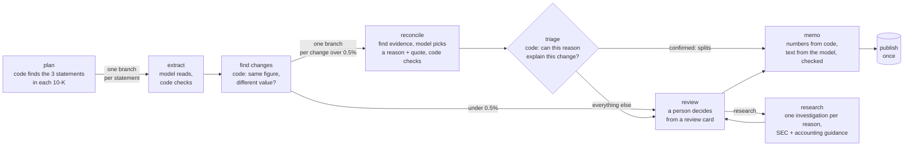

# filings-agent

## 1. The problem

Every public company files an annual report with the SEC, called a 10-K. Each 10-K shows this
year's figures next to the previous years'. Sometimes a previous year's figure is not the number the
company reported the first time. This is called a restatement.

For example, GE reported net income of $225 million for 2022. A year later, its next 10-K showed
$339 million for the same year.

Seeing that the number changed is easy. Knowing why it changed is the hard part, and the reason
decides what the change means:

| Reason | What it means for someone using the old figures |
|---|---|
| Stock split | Per-share figures were rescaled. Nothing changed in the business. |
| Spin-off | Past years were redrawn to show only the part of the company that remains. |
| New accounting standard | The rules changed, so old and new years are measured differently. |
| Reclassification | Amounts moved between lines. Totals usually stay the same. |
| Error correction | The first number was wrong. |

The reason is written somewhere in a report of around 150 pages, often without the word "restate".
Today someone has to read the report to find it.

## What this agent does

Given a list of companies, it reads their 10-Ks and:

1. extracts key figures (revenue, net income, debt and others), each with the line it came from;
2. finds figures that a later report changed;
3. explains the reason for each change with a quote from the report, and checks that the quote is
   really there;
4. checks with accounting rules whether that reason can explain that change;
5. sends anything code can't confirm to a person, who sees the evidence for every possible reason;
6. publishes the figures, the decisions and a short memo, once.

Every figure is graded against XBRL, the SEC's machine-readable copy of the same reports. The agent
never sees it.

Built with LangGraph and LangSmith, with models on Amazon Bedrock. Python 3.12, FastAPI,
pyright strict, 428 offline tests, and a React review screen for the person in the loop.

> **Screen recording:** _link to be added_ · **Repository:** [github.com/jduval7/filings-agent](https://github.com/jduval7/filings-agent)

## Quickstart

You need [uv](https://docs.astral.sh/uv/) and Node 22 (or 20.19+). No credentials, no model calls:

```bash
git clone https://github.com/jduval7/filings-agent.git && cd filings-agent
make demo        # then open http://localhost:8000
```

The review screen opens with a Demo panel of nine scenes, one per design decision. Each links to
its traces and experiments in LangSmith. To run it on live SEC data, see
[Run it yourself](#10-run-it-yourself).

## How to read this

| Read | You'll learn |
|---|---|
| [Why it matters](#2-why-it-matters) and [what makes it hard](#3-what-makes-it-hard) | why this needs an agent you can check, not just a model |
| [How it works](#4-how-it-works) | the steps, and where code checks the model |
| [One failure, start to finish](#5-one-failure-start-to-finish) | how the evals found a real mistake and what I changed |
| [How I know it works](#6-how-i-know-it-works), then [EVALS.md](EVALS.md) | the datasets, the checks and the results before and after |
| [Where it falls short](#7-where-it-falls-short) and [the traces](#9-traces-and-experiments) | what still fails, and LangSmith links to see it yourself |

Each design choice, with its evidence and date, is in [DECISIONS.md](DECISIONS.md).

---

## 2. Why it matters

Investors, analysts and auditors use past figures to compare years, build models and test
strategies. If an old figure changed and they don't know why, they can reach the wrong conclusion.
A common example: a strategy tested on today's corrected figures assumes investors knew those
figures years ago, so the strategy looks better than it really was. This is why data providers
such as S&P sell "point-in-time" data that keeps the original figures
([S&P Compustat Point In Time](https://www.globalcustodian.com/standard-ampamp-poor39s-compustat-enriches-analytics-of-investment-landscape-with-precise-data-picture/)).

It happens often, and it's getting harder to see:

- In the 95 reports this project uses (21 companies), 71 of the figures I track were changed by a
  later report. I picked companies that had these events, so this isn't an average rate, but it
  shows how much can move.
- Companies now correct most errors inside their next report instead of announcing them. These
  quieter corrections were about a third of all corrections in 2005 and three quarters by 2020
  (Audit Analytics data, reported by [Cooley](https://cooleypubco.com/2022/03/15/acting-chief-accountant-materiality-restatements/)).
- Fewer corrections use the word "restate": over 93% did in 2006, 44% in 2012
  ([Audit Analytics](https://blog.auditanalytics.com/restatements-whats-in-a-name/)).

Data providers record *that* a figure changed. In the public documentation I reviewed, none of them
records *why*
([research notes](research_notes/Restatement%20review%20card%20design/practitioner_workflows.md)).
Finding the reason is still done by reading. That reading is what this agent automates. I found no
published figure for how long it takes, so I don't claim a time saving; the
[production plan](#8-checking-it-in-production) measures it.

**Why not just use XBRL?** XBRL has the numbers but not the reasons. In production I would take the
figures from XBRL and spend the model on the explanation. Extraction is in this project because it
works on documents that have no XBRL, and XBRL gives it an exact answer key
([details](DECISIONS.md#2026-10-21-xbrl-vs-reading-the-filing)).

## 3. What makes it hard

1. **The reason is far from the number.** The figure is in a table. The reason is in a note,
   sometimes in a different report, sometimes in vague wording such as "certain prior-year amounts
   have been revised".
2. **Several things happen at once.** In the same reports, GE describes two spin-offs (GE
   HealthCare in 2023, GE Vernova in 2024) and a new insurance accounting standard applied to past
   years. Each could plausibly explain a change.
3. **A wrong answer can come with a real quote.** Most models I tried said GE's net income changed
   because of the spin-off, and quoted a real sentence about it. A check that the quote exists
   passes. But a spin-off can't change total net income: it only moves results from one line to
   another. The real reason was the accounting standard (ASU 2018-12). A quote that exists is not a
   quote that explains the number.
4. **People tend to approve what an AI suggests.** Reviewers anchor on a suggested answer, and an
   explanation makes them more likely to accept it whether it's right or wrong
   ([research summary](reports/Restatement%20review%20card%20design.md)). A reviewer who only
   approves the agent's guess adds little.
5. **Runs must be safe to repeat.** A run can wait days for a reviewer, crash, be retried, or be run
   again next quarter. Each result must be published once, and a later run must not erase a
   person's decision.

## 4. How it works

Each design choice answers one of the difficulties above:

- **Code does what code can do exactly.** Code finds the statements, spots changes, does the
  arithmetic and runs the workflow. The model does three reading jobs: read a table, explain a
  change, write the memo ([per step](DECISIONS.md#2026-10-21-where-llms-are-used-and-why)).
- **Every model output is checked against the report** (difficulties 1 and 3). A figure must be
  printed in the statement. A quote must appear word for word in the report where the number
  changed. If either check fails, the answer becomes "unknown".
- **Accounting rules check that the reason fits the change** (difficulty 3). "A spin-off can't
  change total net income" rules the spin-off out for GE. Only answers code fully confirms skip the
  reviewer. Today that's stock splits.
- **The reviewer sees evidence, not the agent's answer** (difficulty 4). The review card lists every
  possible reason with its evidence and what code ruled out. The agent's own answer is not shown.
- **Results publish once, and every decision is kept** (difficulty 5). Runs are saved after every
  step, a repeated request returns the same run, and the ledger keeps every reviewer decision.



| Step | Done by | What it does |
|---|---|---|
| **plan** | code | Finds the income statement, balance sheet and cash-flow statement in each report, and starts one branch per statement (LangGraph `Send`). |
| **extract** | model, checked by code | The model copies each figure exactly as printed, with its scale ("in millions"). Code converts it and rejects anything that isn't in the statement. |
| **find changes** | code | Compares the same figure across reports. A change under 0.5% is accepted automatically. Larger changes each get a branch. |
| **reconcile** | retrieval + model, checked by code | Code pulls passages about each possible reason from the reports where the number changed. The model picks a reason and quotes the passage. Code checks the quote. |
| **triage** | code | Accounting rules, each citing its source, check whether the reason can explain this change. |
| **review** | person | The workflow pauses (LangGraph `interrupt()`; it can wait days). The reviewer picks the reason, escalates the case, or asks for research. |
| **research** | agents, on request | One LangChain agent per possible reason, in parallel, searching SEC filings and PwC accounting guidance (allowed sites only). Every quote is checked against the page it came from. |
| **memo** | code numbers, model text | Code builds the table. The model writes the text. A check rejects any number that isn't in the table. |
| **publish** | code | Saves the figures, the decisions (with who and when) and the memo in one transaction, once per run. |

**Tools and retrieval.** I also built reconcile as a tool-using agent: a LangChain agent with a
`fact_history` tool and a `search_filing` tool that searches the report by meaning (vector search).
I kept the fixed pipeline in production because it scored higher (23/23 against 0.83 on the
development set, and every agent miss was GE). The agent approach is used for research instead,
where the search really is open-ended and runs only when a reviewer asks
([why](DECISIONS.md#2026-10-21-reconcile-agent-v1-four-harness-bugs-then-an-honest-baseline)).

**Framework patterns.** Where LangGraph or LangChain documents a way to do something, the code
uses it instead of a hand-made version:

- The review pauses with `interrupt()`. An invalid answer is asked again by routing back to the
  review step through a conditional edge, as LangGraph's interrupts guide recommends, never by
  looping around `interrupt()` inside the node.
- The agents retry a throttled model call with LangChain's `ModelRetryMiddleware`, and research
  retries a briefly unavailable source with `ToolRetryMiddleware`, so one throttle doesn't fail a
  whole investigation. They share one definition of a transient error with the graph's
  `RetryPolicy` (`llm/transient.py`), and every attempt goes through the spend guard.
- The agents' cost is bounded with `ModelCallLimitMiddleware` and `ToolCallLimitMiddleware`, and
  their answers use `ToolStrategy` structured output, which behaves the same on every model.
- The research investigations run in parallel on LangChain's `ContextThreadPoolExecutor`, which
  carries the tracing context into each thread, so all of them nest under the research step in
  LangSmith.

### The review card

This is what a reviewer sees for GE's net income:

```
GE:net_income FY2022: 225,000,000 -> 339,000,000 (+50.7%)
| cause                   | fits the numbers? | why                                                    |
| stock_split             | ✗ ruled out       | a stock split changes share counts, not dollar amounts |
| discontinued_operations | ✗ ruled out       | net income attributable includes discontinued ops, so a spin-off moves amounts between lines, not the total |
| accounting_change       | ? possible        | ...                                                    |
| reclassification        | ? possible        | ...                                                    |
> On January 1, 2023, we adopted ASU No. 2018-12, ... Targeted Improvements to the Accounting for Long-Duration Contracts
Decide: pick the cause (accept / use_original), escalate, or research further.
```

The reasons are always in the same order, and only code rules mark one as ruled out.
`uv run filings-agent cards --case GE:net_income:FY2022` prints this card.

## 5. One failure, start to finish

GE's 2022 net income ($225 million, later $339 million) shaped most of this project:

| | What happened | What I did |
|---|---|---|
| 1 | A run said the spin-off caused GE's change. A reviewer corrected it during the review pause. | The correction is saved with the exact input the model saw. |
| 2 | The correction became a test, and the CI check failed. | Looking into it, I found prompt drift and two bugs in my quote checker. After the fix: 23/23. |
| 3 | The tool-using agent version scored 0.30 on reasons. | The LangSmith traces showed four bugs in my code around the agent, not model mistakes. After the fix: 0.83. |
| 4 | The agent was still wrong on GE, with a real quote that passed the quote check. | Splitting results by company showed every failure was GE. The check proved the quote existed, not that it explained the number. |
| 5 | Close that gap where code can. | Added triage rules. "A spin-off can't change total net income" now sends the answer to a person, with the reason. |
| 6 | The reviewer shouldn't just approve the agent's guess. | Built the review card: every reason with its evidence, and no favorite. |
| 7 | Some cases need more digging. | Added research: one investigation per reason over SEC filings and accounting guidance. |
| 8 | Does this work beyond GE? | Tested on 11 hard cases (evidence for the true reason found in 11/11), then on five insurers I added after I stopped tuning: pipeline 12/12, research 6/6, no wrong answers given with confidence. They are new companies but the same accounting standard as GE, so this is a narrow test. |
| 9 | Does it stay good? | Reviewer decisions are recorded on each trace in LangSmith, runs that need a person go to a review queue, and the CI check runs on every pull request. |

## 6. How I know it works

**What "good" means, in order:**
1. **Never wrong with confidence.** An "unknown" costs the reviewer the same time as today. A
   confident wrong answer that skips the reviewer costs trust.
2. **Every claim can be checked in seconds**, from the printed figure and the quote.
3. **Correct**, against XBRL for figures and hand labels for reasons.
4. **Cheap and fast enough** to run every filing season.

**Datasets.** All are in LangSmith. They are split by company, so the test companies were never
seen while tuning. "Fresh" companies were added after I stopped making changes, as a check that the
results hold on new cases. More detail: [EVALS.md](EVALS.md#datasets).

| Dataset | Size | Correct answer | What it covers |
|---|---|---|---|
| `extract-{dev,test}` | 57 / 36 statements | every figure, from XBRL | normal statements, plus tricky ones: a scale change inside a table, 52/53-week years, figures a company doesn't report |
| `reconcile-{dev,test}` | 23 / 12 changes | the reason, labelled by hand with the passage that shows it | stock splits and spin-offs; a reclassification that appears only in test; GE's overlapping events |
| reconcile, fresh | 12 changes | the reason | accounting changes at five insurers, added after tuning stopped |
| `reconcile-corrections` | grows with use | the reason a reviewer chose | real mistakes, replayed with the exact input the model saw |
| prompt injection | 3 cases | the true reason, not the planted one | a passage planted in the report telling the model which answer to give |
| `research-hard`, `research-fresh` | 11, 6 | evidence for the labelled reason | the cases code can't confirm |
| `memo-{dev,test}`, `e2e-dev` | 5 / 3, 4 | numbers in the table; the right path through the workflow | memo writing; whether runs stop for review when they should |

**Checks.** Where there's a right answer, the check is plain code: figures against XBRL (F1
score), reasons against labels, quotes word for word, triage rules, the review card (the true
reason must never be ruled out), memo numbers against the table, and the agent's tool calls. An LLM
judge is used only for the memo's writing quality, where judgment is needed. It is a different
model family from the writer, and both orders are tried when comparing two memos. I built the
calibration against human labels, but the labels aren't done yet, so judge scores are
[indicative only](EVALS.md#the-llm-judge-honestly).

**Results.** Full tables, breakdowns and caveats are in [EVALS.md](EVALS.md#before-and-after).

| | Result | Notes |
|---|---|---|
| Extraction (gpt-oss-120b) | F1 **0.998** on held-out test companies | my first version, one call per report: F1 0.40 |
| Reconcile (claude-sonnet-4.6, pipeline) | **12/12** test, 23/23 dev | includes a reason never seen while tuning |
| Changes code approves alone | 26% dev / 42% test of material changes skip review, **0 wrong** | "material" means a change over 0.5%. Stock splits only, by design. With 0 of 11 auto-approved wrong, the real error rate could still be as high as 27% (95% confidence) |
| Review card | true cause never ruled out (33/33); of all candidate causes shown, 27% ruled out by code, 14% no evidence, 59% left open | measured by code, no model |
| Research (on request) | true cause gets verified evidence on **17/17** hard cases (11 + 6 fresh); about $0.70 and 25 seconds per case | each investigation looks for its own reason, so wrong reasons get supporting quotes too: 0.9 per hard case, 0.3 per fresh case. Research adds evidence; the person decides |
| New companies (fresh) | 12 accounting changes at 5 insurers never seen while tuning: pipeline **12/12**, agent 0 confident-wrong, card never rules out the true cause | nothing retuned, and all 12 are the same standard as GE's. I checked each label against the company's own adoption table: 10 add up exactly, and Aflac's 2 are supported by the company's text but it prints no table. On the 10 that add up: pipeline 10/10, agent 9/10, research 5/5 |
| Cost | about $0.14 to analyse 2 companies end to end | $0 when re-run from cache |

**Before and after:**

| What the evals showed | Before | After |
|---|---|---|
| One model call per whole report fails on long reports | F1 0.40, 68% of calls failed | code finds the statements, one call each: **F1 0.995**, 1% failed |
| The best model for extraction was the worst at explaining | one model for everything | a model per step, chosen by testing 10 models |
| A reviewer's correction failed the CI check | 0.913 | prompt drift and two checker bugs fixed: **23/23** |
| The agent's traces showed bugs in my code, not model mistakes | 0.30 | **0.83** |
| A real quote "verified" a wrong reason for GE | wrong, and would have skipped review | a triage rule sends it to a person with the reason |

## 7. Where it falls short

The full list, with what would fix each: [EVALS.md](EVALS.md#known-failures-and-open-questions).

- **Checks prove that evidence exists, not that it explains the number.** Triage covers stock
  splits and spin-offs against net income. Everything else goes to a person.
- **Small datasets.** The samples are small (45 labelled restatements, 17 research cases, 3
  injection cases), and the fresh cases all involve one accounting standard.
- **The fresh test can't tell a good reasoner from a lucky one.** All 12 fresh cases have the same
  answer (an accounting change), so a program that always said "accounting change" would also score
  12/12. The pipeline doesn't know that and chooses among the same five reasons it uses everywhere,
  but this set can't show it. The real test is a fresh set with mixed reasons. Lincoln (LNC, already
  in the data) adopted the same standard and corrected an error in the same years, so it's the
  next case to label.
- **The judge isn't calibrated yet.** When comparing two memos, it changed its verdict 40% of the
  time just because the order changed.
- **Only three accounting rules exist**, each citing its source. Adding more needs an accountant.
- **Research summaries can draw the wrong conclusion from a real quote.** The card shows the quote
  first and labels the summary as unverified.
- **Prompt injection is tested only on the agent version**, which isn't used in production.
  Research reads live web pages and relies on an allowlist and quote checks, which aren't measured.
- **I don't know yet whether the card makes reviewers faster or more accurate.** The production
  plan measures it.

**Questions I haven't settled:**

- **When two reviewers disagree across runs, who wins?** Today a reviewer's chosen reason outranks
  a later escalation, and the escalation is shown next to it. But an escalation can mean "the
  earlier answer was wrong" or "I couldn't tell", and those need different handling.
- **Should an escalated case publish now as "unknown", or wait for an answer?** It publishes now.
  Changing it is small; deciding which is right is the open part.
- **Is auto-approval safe enough?** 0 wrong out of 11 still allows an error rate up to 27%. The
  production plan sends a random sample of auto-approved changes to a person.

## 8. Checking it in production

| What to watch | How |
|---|---|
| Is each run healthy? | code checks posted to each LangSmith trace (`online.*`): failed branches, unknown reasons, failed quote checks, memo check, cost |
| Which runs need a person? | sent to a LangSmith review queue, with the reason |
| What did reviewers do? | recorded on each trace (`review.*`): agreement with the agent's hidden answer, escalations, research requests |
| Do mistakes become tests? | two doors, one suite: a reviewer's correction on the review screen, or a QA catch in the annotation queue (Add to Dataset, then `make import-qa`). Both are saved with the model's exact input and included in every eval and the CI check |
| Did a change make it worse? | every pull request re-scores extraction and reconcile against fixed thresholds ($0 when nothing changed, thanks to the cache) |
| How often is auto-approval wrong? | *to add:* send a random 5% of auto-approved changes to a person |
| Are reviewers paying attention? | *to add:* mix known-wrong cards into the queue and count how many are caught |
| Is the memo's prose any good? | LangSmith's online evaluator grades a sample of published memos against their table (an OpenAI judge, the memo rubric); its scores count once it agrees with my labels (calibration in progress) |
| Does it save time? | time per card, reviewer alone against reviewer with the card, from the review screen |

Details and alert thresholds: [EVALS.md](EVALS.md#how-wed-evaluate-it-in-production).

## 9. Traces and experiments

Public links, no LangSmith account needed:

| What it shows | Link |
|---|---|
| The agent version blames GE's change on the spin-off, with a real quote | [trace](https://smith.langchain.com/public/1c207dce-2875-48fb-a100-187d7a8b25e7/r) |
| Research: the accounting-change investigation finds GE's ASU 2018-12 adoption | [trace](https://smith.langchain.com/public/54eea7f2-e96a-4131-97c4-5ed9403b3853/r) |
| A GE run splits into one branch per statement and pauses for review | [trace](https://smith.langchain.com/public/972f1da8-670d-4791-a8b7-ce171136a3d4/r) |
| The run resumes after review, publishes once, and the reviewer's decisions are recorded | [trace](https://smith.langchain.com/public/7544fb0f-87bc-4c77-a9f8-06894c7a78ef/r) |
| Reconcile dataset and experiments: pipeline 1.00 against agent 0.83, and the model comparison | [dataset](https://smith.langchain.com/public/b8630805-d17a-4ff7-bc68-f79c277f558f/d) |
| Extraction on held-out companies: gpt-oss holds (F1 0.998), Haiku drops (0.928) | [dataset](https://smith.langchain.com/public/f0c2c86f-329e-4e34-90e1-5ac319056b42/d) |
| Research on 11 hard cases | [dataset](https://smith.langchain.com/public/5b1f07b7-926a-4dbd-b2ce-5885b70c159f/d) |
| Research on 6 cases from the fresh insurers | [dataset](https://smith.langchain.com/public/97aad40a-0861-4a0a-8420-2c125ee7688b/d) |

Triage is plain code with no model call, so it has no trace.
`uv run filings-agent cards --case GE:net_income:FY2022` shows the spin-off ruled out with the reason.

- **With access to the LangSmith project:** `make demo-links` prints every page the demo uses.
- **Your own runs:** with `LANGSMITH_TRACING=true`, every run is traced in project `filings-agent`,
  tagged by step, company and model.
- **Experiments:** `uv run filings-agent upload-datasets`, then `sweep <step>`.
  [RUNBOOK.md](RUNBOOK.md#2-where-everything-is-in-langsmith) lists every dataset, experiment and queue.

## 10. Run it yourself

**See everything without credentials: `make demo`.** It needs only `uv` and Node. It opens the review
screen with a Demo panel of nine scenes, one per design decision: the fan-out, the easy lane, a
review, research, a published run, a crash and resume, two reviewers across runs, annotations, and
the evals. Each scene has an **In LangSmith** strip: the page to open and what to point at. They run
on the real graph and API, with filings and model answers recorded in `demo/data/`; a model call
that wasn't recorded is refused, never sent. With no LangSmith key the scenes link to the public
traces and datasets. With a key in `.env`, the scenes' own runs are traced to the project
`filings-agent-demo` and monitored like production (online checks, reviewer feedback, an annotation
queue). `make demo-studio` opens the same graph in LangGraph Studio, also on the recordings. CI runs
`make demo-check` on every pull request. Each scene explains itself on screen.

To run it on live data:

```bash
make setup
cp .env.example .env    # SEC_USER_AGENT, LANGSMITH_API_KEY, LANGSMITH_TRACING=true, AWS_PROFILE (Bedrock)
make data               # download 95 reports, build the answer key and eval datasets (cached)
make check              # ruff + pyright strict + 428 tests (no network, no LLM)

uv run filings-agent run --tickers GE,NVDA                  # runs, then pauses for review
uv run filings-agent cards --thread <id>                    # the review cards it's waiting on
uv run filings-agent review --thread <id> --tickers GE,NVDA --decisions decisions.json
```

One decision per change waiting for review, for example:

```json
{"GE:net_income:FY2022": {"action": "accept", "correct_cause": "accounting_change"},
 "GE:revenue:FY2022":    {"action": "research", "note": "check the 8-K for the Vernova spin-off"},
 "X:cash:FY2023":        {"action": "escalate", "note": "none of these fit"}}
```

**Review screen:** `make web && make serve`, then open http://localhost:8000. Try NVDA first (stock
splits, all confirmed by code, nothing to review), then GE (ten changes need a decision). You can
watch the run, decide each card, and see the result publish.

**LangGraph Studio:** `AWS_PROFILE=... make studio`, then open
`https://smith.langchain.com/studio/?baseUrl=http://127.0.0.1:2024` in Chrome and enter
`{"tickers": ["NVDA"]}`. It runs step by step and pauses at review.

**HTTP API** (`make serve`, port 8000):

| | |
|---|---|
| `POST /analyses` | Start a run. Sending the same request again returns the same run. An `Idempotency-Key` header names the request; reusing a key with a different request is refused (422). A new report on disk or a changed setting counts as a new request. `fresh: true` always starts a new run. |
| `GET /analyses`, `GET /analyses/{id}` | Recent runs; one run's status, figures, cards waiting for review and memo. |
| `GET /analyses/{id}/events` | Live progress (Server-Sent Events). |
| `POST /analyses/{id}/review` | A decision for every waiting change, plus the `review_token` of the cards you saw. The server records who decided and when. |

## 11. Safeguards

| Risk | Safeguard | Where |
|---|---|---|
| The model invents a number or a quote | every figure must be printed in the statement and every quote must appear word for word, or the answer becomes "unknown" | `steps/extract.py`, `steps/reconcile.py`, `research/agent.py` |
| A real quote supports the wrong reason | accounting rules (citing ASC 260-10-55-12 and ASC 205-20-45-3A) rule reasons out; only answers code fully confirms skip review | `steps/triage.py` |
| Reviewers approve whatever the AI says | the card never shows the agent's answer, and picking a reason code ruled out shows a warning | `steps/card.py`, `web/` |
| A wrong answer gets published | nothing publishes without a person's decision unless code confirmed it; incomplete or out-of-date reviews are refused | `graph/build.py`, `api/app.py` |
| A later run erases a reviewer's decision | every decision is kept in the ledger's history, and a person's choice outranks an escalation or an automatic answer | `storage/ledger.py` |
| Two processes run the same analysis | each run holds a lock in the database while it runs | `storage/leases.py` |
| Anyone can approve figures | API tokens, with the reviewer's name saved on each decision; without tokens the server only accepts local connections | `api/app.py`, `cli.py` |
| Instructions hidden in a web page | fetched text is treated as data; research only reads allowed sites and can only cite pages it read; tested on the agent version (planted instruction followed 0 of 3 times) | `research/sources.py`, agent eval |
| Runaway cost | every Bedrock call reserves its worst-case cost against a $30 project cap and a monthly account cap before it's sent; research runs only when a reviewer asks | `llm/spend_guard.py` |
| The judge grading its own work | the config refuses a judge that is also a writer | `config.py` |
| Secrets in CI | no long-lived keys: AWS access through OIDC, limited to calling Bedrock | `.github/workflows/ci.yml` |

**Personal data:** the inputs are public SEC filings. The only personal data stored is what
reviewers enter (their name, decisions and notes, in the local ledger and in LangSmith) and the SEC
contact email in `SEC_USER_AGENT`, which is sent only to sec.gov as the SEC requires. In production,
reviewer notes would be deleted after a set period and kept out of shared datasets.

## 12. What the brief asked for

| Asked for | Where |
|---|---|
| A working agent with a useful tool and a retrieval step | [How it works](#4-how-it-works): evidence retrieval in reconcile, the tool-using agent version (`fact_history`, `search_filing`), the research agents |
| An eval dataset with expected outcomes: normal cases, edge cases, real failures | [Datasets](#6-how-i-know-it-works), [EVALS.md](EVALS.md#datasets) |
| Code checks, and an LLM judge where judgment helps | [Checks](#6-how-i-know-it-works) |
| Traces | [Traces and experiments](#9-traces-and-experiments) |
| Results before and after | [Before and after](#6-how-i-know-it-works), [EVALS.md](EVALS.md#before-and-after) |
| Failures, tradeoffs, open questions | [Where it falls short](#7-where-it-falls-short) |
| How you'd evaluate it in production | [Checking it in production](#8-checking-it-in-production) |
| Optional extras | judge calibration (built, labels pending), results by company, split, reason and lane, agent tool-call checks, tricky examples (prompt injection, the fresh companies), automatic checks on every trace, safeguards, live progress, Makefile and CI |

## 13. Other docs

| Doc | For |
|---|---|
| [EVALS.md](EVALS.md) | the full evaluation: datasets, checks, before and after, failures, production plan |
| [DECISIONS.md](DECISIONS.md) | every design choice with its evidence, dated, including the mistakes the evals caught |
| [RUNBOOK.md](RUNBOOK.md) | running it: analyses, reviews, evaluating a change, incidents, costs |
| [CONTRIBUTING.md](CONTRIBUTING.md) | changing it: how it fits together, where things live, rules not to break |
| [MAINTAINING.md](MAINTAINING.md) | owning it: onboarding, the weekly improvement loop, investigating a new failure |

## 14. How I used coding assistants

I used a coding assistant the way I'd use a fast engineer on my team: to scaffold code, write
tests, run model sweeps and draft documentation. The decisions that shape the product were mine,
and [DECISIONS.md](DECISIONS.md) marks them "with the author": sending answers to a person unless
code can confirm them, a review card that never shows the agent's answer, and letting the reviewer
ask for research. I also had it review its own work in separate passes, and each bug it found is
now fixed with a test.

I didn't take its word for results. Every number in these docs is recomputed from the eval data by
a script (`make receipt`), which flags any sentence that no longer matches. It drafted the labels for the
fresh insurers; I checked each one against the company's own filing on sec.gov, and the labels file
records how each was verified.
